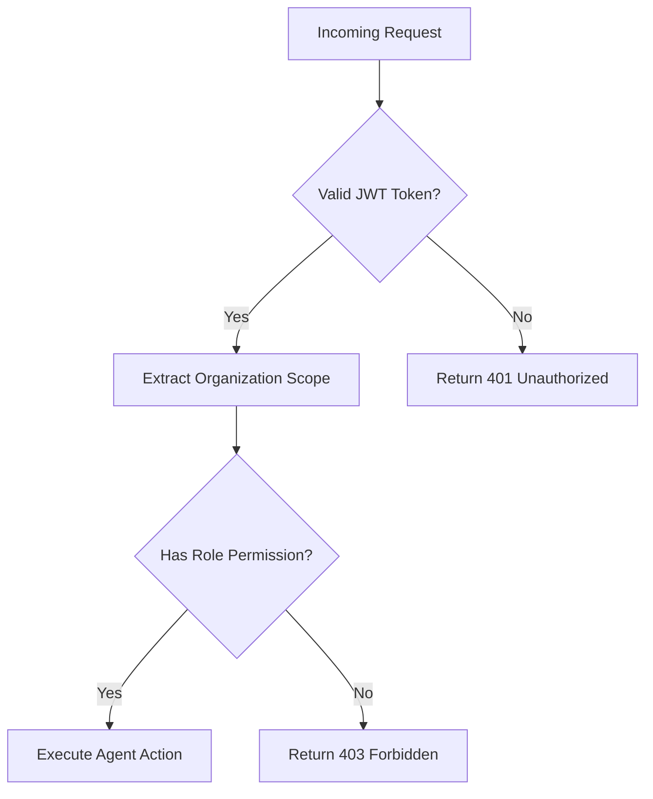

# AI Ethics, Limitations, & Interpretability in Developer Tools

## 1. Overview & Context

As AI becomes deeply integrated into the software engineering lifecycle (AIDevOps), developer tools transition from passive text editors to active, autonomous agents generating and refactoring production code. This architectural shift introduces critical ethical, security, and interpretability challenges that must be systematically managed.

---

## 2. Key Ethical & Technical Challenges

```
┌────────────────────────────────────────────────────────────────────────┐
│                   AI IN SOFTWARE ENGINEERING RISKS                     │
├───────────────────┬────────────────────┬───────────────────────────────┤
│    LEGAL & IP     │      SECURITY      │       INTERPRETABILITY        │
├───────────────────┼────────────────────┼───────────────────────────────┤
│ • GPL Licensing   │ • Hallucinated Pkgs│ • Black-box Refactoring       │
│ • Code Attribution│ • Prompt Injection │ • Silent Logic Regressions    │
│ • Trade Secret Leak│ • Secret Exposure │ • Overconfidence Bias         │
└───────────────────┴────────────────────┴───────────────────────────────┘
```

### 2.1 Intellectual Property & Licensing Contamination
- **Training Data Provenance**: Code completion models (e.g., Code Llama, StarCoder, Copilot) are trained on billions of public repositories. Inadvertent reproduction of copyleft-licensed code (GPL-3.0, AGPL) into proprietary codebases can create legal exposure ("license contamination").
- **Nexus Safeguards**:
  - Code Intelligence symbol tracing to inspect provenance.
  - Workspace configuration to enforce permissive license matching (MIT, Apache-2.0, BSD).

### 2.2 Hallucinated Dependencies & Supply-Chain Attacks (Slopsquatting)
- **The Threat**: LLMs frequently invent non-existent package names when writing code (e.g., `import { parseJwtFast } from 'jwt-fast-validator'`). Attackers scan public code or prompt completions, register these phantom packages on npm/PyPI with malicious payloads, and compromise unsuspecting developers.
- **Nexus Safeguards**:
  - `code-completion` prompt templates explicitly forbid introducing new dependencies without existing `package.json` validation.
  - Verification stage in production chains to run `npm ls` or dry-run dependency checks before execution.

### 2.3 Secret Leakage & Telemetry Privacy
- **The Threat**: Sending codebases to third-party proprietary LLM APIs risks exposing hardcoded API keys, database credentials, or proprietary business logic.
- **Nexus Safeguards**:
  - **BYOK (Bring Your Own Key)** architecture with AES-256 encrypted key storage at rest.
  - Local OSS model support via OpenClaw Gateway (Code Llama, StarCoder2, Ollama) ensuring zero code leaves the on-premise boundary for high-security environments.

### 2.4 Over-Reliance and Skill Degradation (Automation Bias)
- **The Threat**: Developers accepting AI suggestions without rigorous review, leading to code comprehension deficits and subtle logic errors passing code reviews.
- **Nexus Safeguards**:
  - **Human-in-the-Loop (HITL) Approvals**: Mission-critical actions (database migrations, deployment, production chain stage completions) require explicit human sign-off.
  - Granular severity badges (🔴 Critical, 🟡 Warning, 🔵 Info) to force deliberate attention on high-risk findings.

---

## 3. Model Interpretability & Explainability

### 3.1 Explainable AI (XAI) in Code Reviews
When Nexus agents flag a bug or suggest a refactoring, they cannot merely output a binary verdict. Nexus implements a **5-Layer Explainability Framework**:

1. **Location Tagging**: Pinpoint exact file path, start/end line, and symbol name.
2. **Trigger Condition**: Explicitly state *why* and *when* the bug manifests (e.g., `"Triggered when req.body.users is empty or null"`).
3. **Before vs After Diff**: Side-by-side syntactic diff illustrating the transformation.
4. **Pattern Classification**: Labeling by standard Gang of Four (GoF) or Fowler refactoring pattern names (e.g., *Replace Conditional with Strategy*).
5. **Confidence & Severity Scoring**: Disclosing the model's confidence level to prevent false certainty.

### 3.2 Visualizing Complex Logic (Mermaid Flowcharts)
For complex algorithms, Nexus prompts are engineered to generate interactive Mermaid diagrams, translating abstract AST changes into human-verifiable visual flows:



---

## 4. Nexus Responsible AI Checklist

| Item | Requirement | Nexus Implementation |
|---|---|---|
| **Auditability** | Complete immutable log of all AI decisions | `ActivityFeed` + `SearchAudit` recording agent prompt, response, and timestamp |
| **Sandboxing** | Safe execution boundaries for AI-generated code | Dedicated workspace roots (`.nexus-workspaces/`) with read/write isolation |
| **Fail-Safe Defaults** | Agents fail gracefully without catastrophic actions | Graceful offline degradation and stuck-run recovery on restart |
| **Transparency** | Clear distinction between human and AI actions | Visual badges and distinct UI avatars throughout the chat and board interfaces |
| **User Control** | 1-click override or termination of runaway agents | `AgentControls` with Pause, Disable, and Status Override controls |
