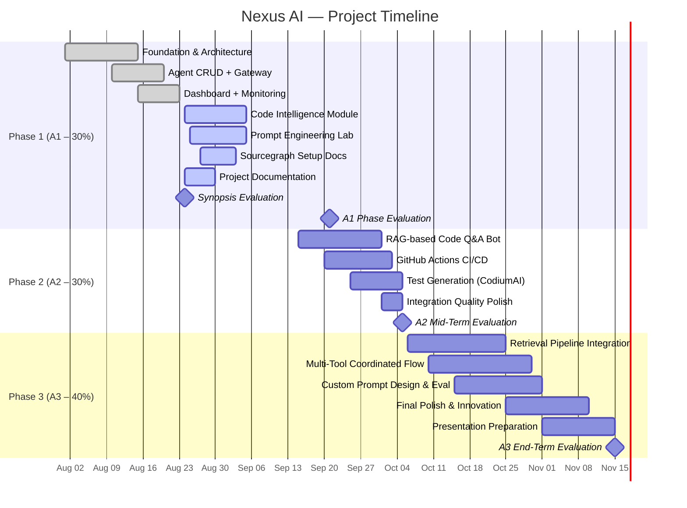

# Project Timeline — Nexus AI

## Overview

---

## Phase 1: Foundation + Code Intelligence (A1 — 30%)

**Dates:** August 1 – September 21, 2026  
**Evaluation:** Week starting September 21st  
**Synopsis Due:** Week starting August 24th

| Week | Deliverables | Status |
|------|-------------|--------|
| Aug 1–8 | Project setup, Prisma schema, Express backend, React frontend scaffold | ✅ Done |
| Aug 8–15 | Auth system (JWT + refresh tokens + email verification), org management | ✅ Done |
| Aug 10–20 | Agent CRUD, OpenClaw Gateway RPC client, multi-gateway support | ✅ Done |
| Aug 15–23 | Dashboard, metrics, topology graph, timeline, alerts, activity feed | ✅ Done |
| Aug 20–25 | Chat interface, workspace file editor, LLM provider management | ✅ Done |
| Aug 24–30 | **Synopsis, Timeline, Team Matrix** (synopsis evaluation starts) | 🔄 In Progress |
| Aug 24–Sep 5 | **Code Intelligence** (semantic search, symbol explorer, dependency graph) | 🔄 In Progress |
| Aug 25–Sep 5 | **Prompt Engineering Lab** (5 templates, playground, version history) | 🔄 In Progress |
| Aug 27–Sep 3 | **Sourcegraph Setup Documentation** + query formulation guide | 🔄 In Progress |
| Sep 5–15 | Testing, bug fixes, documentation polish | ⬜ Planned |
| Sep 15–21 | A1 evaluation preparation, demo rehearsal | ⬜ Planned |

### A1 Rubric Mapping

| Rubric | Weight | Deliverables |
|--------|--------|-------------|
| Synopsis / Problem Definition & UX | 5% | PROJECT_SYNOPSIS.md, PROJECT_TIMELINE.md, TEAM_MATRIX.md, DESIGN_BLUEPRINT.md |
| Prompt Engineering | 5% | 5 prompt templates, Prompt Lab page, PROMPT_ENGINEERING.md |
| Sourcegraph & Semantic Navigation | 10% | Code Intelligence page (4 tabs), SOURCEGRAPH_SETUP.md |
| Tool Configuration & Exploration | 5% | SETUP_GUIDE.md, TOOLING.md, .vscode/ configs |
| Documentation & Accessibility | 5% | README.md, JSDoc comments, ARIA labels, architecture docs |

---

## Phase 2: RAG + CI/CD + Testing (A2 — 30%)

**Dates:** September 15 – October 5, 2026  
**Evaluation:** Mid-Term week (October 5–9)

| Deliverable | Weight | Description |
|-------------|--------|-------------|
| RAG-based Q&A Bot | 10% | LangChain/LlamaIndex integration for code Q&A across repos |
| GitHub Actions CI/CD | 10% | Automated build, test, lint, deploy workflows with Sweep.dev |
| Test Generation | 5% | AI-powered test generation using CodiumAI/Codeium |
| Integration Quality | 5% | Documentation, error handling, edge case coverage |

---

## Phase 3: Final Project (A3 — 40%)

**Dates:** October 6 – End of Semester  
**Evaluation:** As per academic calendar

| Deliverable | Weight | Description |
|-------------|--------|-------------|
| Retrieval & Automation Pipelines | 15% | End-to-end RAG + agent orchestration |
| Multi-Tool Coordinated Flow | 10% | Sourcegraph + CodiumAI + GitHub Actions working together |
| Custom Prompt Design & Evaluation | 5% | Advanced prompt engineering with benchmarks |
| Functional Completeness & Innovation | 5% | Polish, novel features, UX excellence |
| Presentation & Team Contribution | 5% | Demo, viva, individual contribution evidence |

---

## Milestones

| # | Milestone | Date | Deliverable |
|---|-----------|------|------------|
| M1 | Synopsis Evaluation | Aug 24, 2026 | Project Charter, Timeline, Team Matrix |
| M2 | A1 Phase Evaluation | Sep 21, 2026 | Code Intelligence, Prompt Engineering, Sourcegraph, Docs |
| M3 | A2 Mid-Term | Oct 5, 2026 | RAG Bot, CI/CD, Test Generation |
| M4 | A3 End-Term | Nov 15, 2026 | Complete platform with all integrations |
